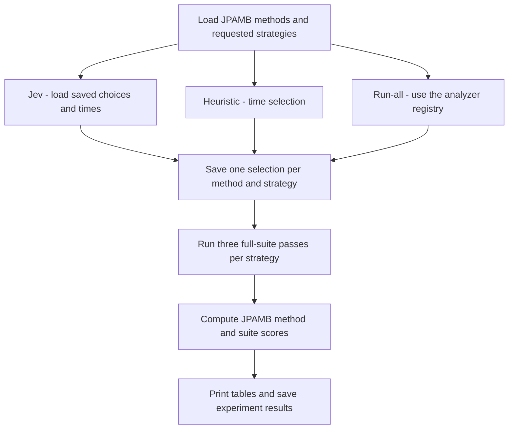
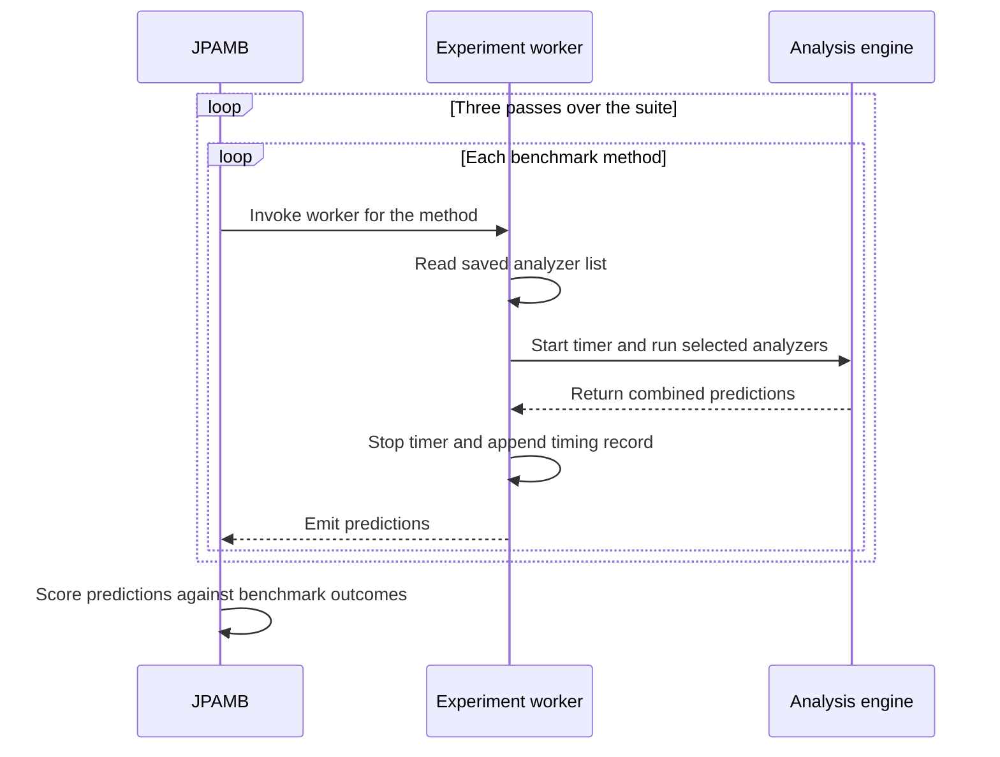

# Running a JPAMB experiment

[`experiment.py`](../experiment.py) compares analyzer-selection strategies on the
same JPAMB benchmark. One experiment can run one or more strategies. It saves
their selected analyzers, timings, predictions, and scores for later
[evaluation](evaluation.md).

## Run an experiment

From the repository root, use the project Python environment with the JPAMB
benchmark already built. See the [setup guide](setup.md).

```bash
source .venv/bin/activate
python experiment.py --strategies run-all
python experiment.py --strategies heuristic run-all
python experiment.py --strategies all \
  --jev-times path/to/jev-times.json \
  --jev-selections path/to/analysis_selections.json
```

| Strategy    | How it obtains analyzers and selection time                                                                 |
|-------------|-------------------------------------------------------------------------------------------------------------|
| `jev`       | Loads saved analyzer choices and precomputed wall-clock selection times. The script makes no Jev API calls. |
| `heuristic` | Times the rule-based selector once per Java method.                                                         |
| `run-all`   | Uses every analyzer registered in the engine and records zero selection time.                               |

Use `--strategies all` by itself to choose all three. The default timeout is
five seconds per JPAMB analyzer invocation. Override it with `--timeout SECONDS`.

### Jev inputs

Any command that includes Jev requires `--jev-times`. Supply a JSON object with
one entry per benchmark method and a finite, nonnegative number of seconds per
entry. This example shows one entry. A full run requires an entry for every
method.

```json
{
  "jpamb.cases.Simple.divideByN:(I)I": 0.42
}
```

`--jev-selections` defaults to the repository's
[`analysis_selections.json`](../solutions/jeving/output/analysis_selections.json).
It is a JSON array with `method_id` and `selected_analyzers` in each record.
Use selections and timings from the **same Jev run**. The script checks that
both files cover the benchmark. A method name without its JVM descriptor is
accepted if it identifies exactly one benchmark method.

## Experiment flow



A **pass** covers every method in the suite once. With 47 methods, one
strategy produces 141 analysis invocations across its three passes. All three
passes reuse the same per-method analyzer lists.



The analysis timer measures elapsed time inside `engine.run()`. The worker
reads the saved selection before the timer and writes the timing record after
it. For each method, `selection_plus_analysis_seconds` adds the selection time
once to the mean of the three analysis timings. The strategy summary sums
these per-method values to estimate the time to select and analyze the suite
once. This figure excludes worker startup, report writing, and JPAMB scoring.

## Read the output

The script prints per-method results and a strategy summary. It writes files
under `reports/experiment-YYYY-MM-DDTHH-MM-SSZ-<unique-code>/` by default.
The timestamp uses UTC. Pass `--output-dir PATH` to specify a new output
directory.

| File | Contents |
| --- | --- |
| `<strategy>-selections.json` | Analyzer list and selection time for each method. |
| `<strategy>-analysis-times.jsonl` | One timing record per method invocation, in pass order. |
| `<strategy>.sexp` | The native JPAMB report. |
| `methods.csv` | One row per strategy and method, with each pass's time and predictions, expected outcomes, and JPAMB score. |
| `results.json` | Per-method records with nested pass results, plus strategy-level timings and JPAMB scores. |

In the CSV, `analysis_seconds_2` and `predictions_2` refer to the same method
during pass two. Use the strategy's JPAMB score for the full-suite comparison
and the per-method predictions to explain individual differences.
